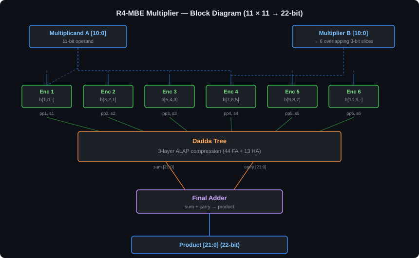
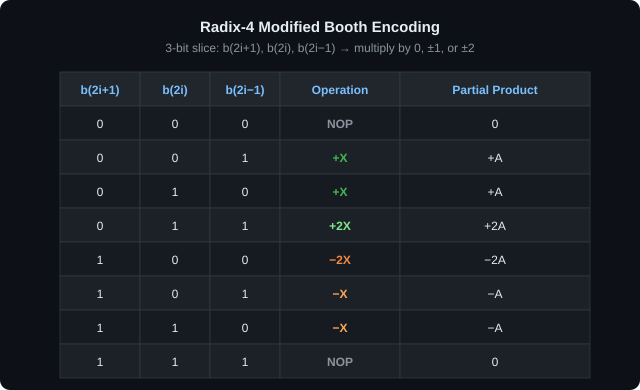
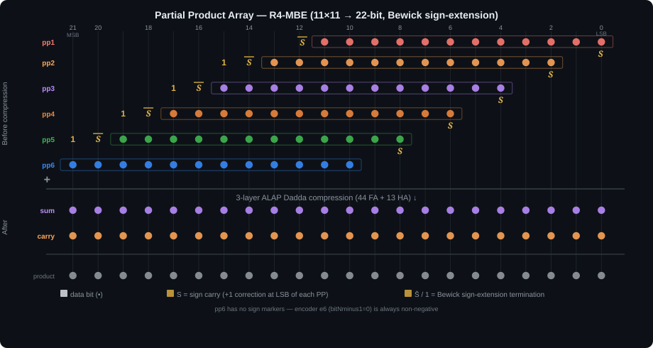
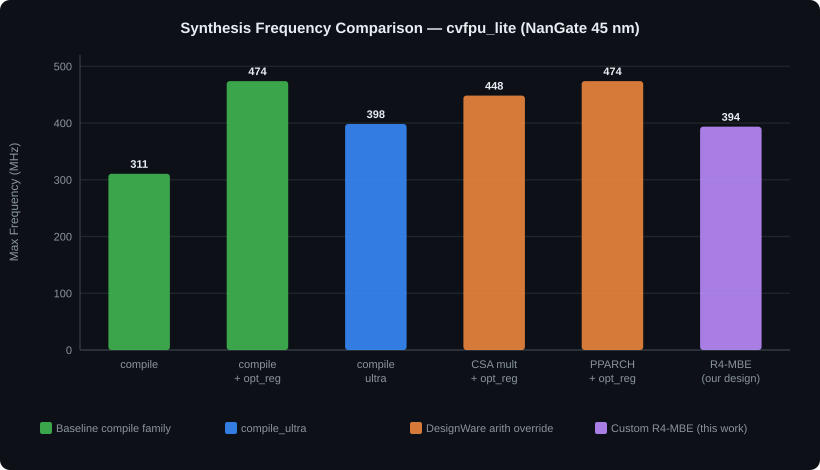

# Radix-4 Modified Booth Multiplier — IEEE 754 FPU Integration

> A structural **Radix-4 Modified Booth Encoding (R4-MBE)** multiplier with a hand-allocated **Dadda tree** and Bewick sign-extension simplification, built in SystemVerilog and integrated as the mantissa multiplier of an IEEE 754-2008 half-precision FPU. The baseline FPU is first benchmarked across five Synopsys Design Compiler strategies (up to **473.9 MHz**), then re-synthesized with the custom multiplier (**393.7 MHz, 3986 µm²**, within 1.2% of DC's own inferred multiplier in frequency).

   

---

## Overview

This project covers two connected parts of a hardware-arithmetic design flow:

**Part 1 — FPU synthesis benchmarking.** The `cvfpu_lite` FPU (a reduced version of the [OpenHW Group cvfpu](https://github.com/openhwgroup/cvfpu)) is verified in half precision (FP16) and synthesized with five Design Compiler strategies, including forcing the DesignWare mantissa multiplier to a CSA or PPARCH architecture.

**Part 2 — R4-MBE multiplier.** An 11 × 11 → 22-bit unsigned multiplier is designed from scratch: six radix-4 Booth encoders generate the partial products using only shifts and bitwise complements, and a 3-layer Dadda tree of 44 full adders and 13 half adders reduces them to two rows. The multiplier is verified standalone, then dropped into the FPU in place of the behavioural `*` operator and re-synthesized.

**C Model** → **SystemVerilog RTL** → **RTL Simulation (QuestaSim)** → **Logic Synthesis (Synopsys DC)** → **Gate-level Simulation**

All designs target the NanGate 45 nm Open Cell Library.

---

## Design Specification

| Parameter | Value |
|---|---|
| FP format | IEEE 754-2008 half precision (FP16): 1 sign, 5 exponent, 10 mantissa bits |
| FPU operation exercised | `MUL`, rounding mode RNE |
| Mantissa multiplier operands | 11 bits (10-bit mantissa + hidden bit), unsigned |
| Product width | 22 bits |
| Encoding | Radix-4 Modified Booth (3-bit overlapping slices) |
| Partial products | 6 × 12-bit + 1 sign bit each |
| Adder plane | Dadda tree, ALAP allocation, 3 layers |
| Compressors | 44 full adders + 13 half adders |
| Final adder | Behavioural `sum + carry` (`always_comb`), mapped by DC |

The FPU joins the hidden bit to each 10-bit mantissa before multiplying, so the multiplier needs 11-bit operands and a 22-bit product rather than 10 and 20.

---

## Design Flow

### Stage 1 — C Model

Two C programs were written to understand the arithmetic before the RTL:

- `booth_multiplier.c` — a plain radix-4 shift-and-add multiplier that scans the multiplier two bits at a time (digits 0–3, no Booth recoding). Test case: 255 × 255 = 65025.
- `modified_booth_multiplier.c` — the full radix-4 MBE algorithm: overlapping 3-bit groups, recoding into {0, ±X, ±2X}, and summation of the signed partial products. It prints each group and partial product. Test case: 896 × 608 = 544768.

### Stage 2 — FPU RTL Verification

The unmodified `cvfpu_lite` was simulated with 10 FP16 operand pairs, generated by `data_gen16.vhd` and chosen to cover positive and negative operands, overflow to infinity and fractional values. The expected results were cross-checked with a FlexFloat-based `fp16_num` utility provided with the course.

| # | A | B | A × B | Result (hex) |
|---|---|---|---|---|
| 1 | 15 | 204 | 3060 | `69FA` |
| 2 | 204 | 1024 | +∞ (overflow) | `7C00` |
| 3 | 1024 | −15 | −15360 | `F380` |
| 4 | −15 | −204 | 3060 | `69FA` |
| 5 | −204 | −1024 | +∞ (overflow) | `7C00` |
| 6 | 68.1875 | 8.70312 | 593.5 | `60A3` |
| 7 | 0.331299 | 60.9375 | 20.1875 | `4D0C` |
| 8 | 953 | 5.71094 | 5444 | `6D51` |
| 9 | −41.5 | 130.375 | −5412 | `ED49` |
| 10 | 1.33984 | −1010.5 | −1354 | `E54A` |

### Stage 3 — Logic Synthesis of the Baseline FPU

For each strategy the clock was first constrained to 0 ns and then relaxed until timing was met with zero slack, giving the maximum frequency. Every netlist was re-simulated with the gate-level testbench and matched the RTL results.

### Stage 4 — R4-MBE Multiplier RTL

The multiplier is described structurally: `Radix4Encoder` → `DaddaTree` (built from `FullAdder` / `HalfAdder` instances) → final addition. It was simulated standalone with 10 operand pairs and checked against the expected products in the waveform.

### Stage 5 — FPU Integration and Re-synthesis

In `fpnew_fma.sv`, the behavioural mantissa product

```systemverilog
assign product = mantissa_a * mantissa_b;
```

was replaced with a `BoothMultiplier` instance. The modified FPU reproduced all 10 FP16 results from Stage 2 exactly, at both RTL and gate level, after synthesis with `compile_ultra`.

---

## Architecture

<div align="center">

</div>

### Radix-4 Booth Encoding

Each encoder looks at a 3-bit slice of the multiplier, `{y(2i+1), y(2i), y(2i−1)}`, with `y(−1) = 0` for the first slice and `y(11) = 0` above the MSB. Each slice selects one operation on the multiplicand:

<div align="center">

</div>

No adder is used to form a partial product:

- **+X / +2X** — the multiplicand, or the multiplicand shifted left by one (wiring only)
- **−X / −2X** — the bitwise complement `~X` / `~(X << 1)`, with `sign = 1`. The missing `+1` of the two's complement is added later in the tree as the bit **S**.

The extra 12th bit of every partial product holds the ×2 case. Because the operands are unsigned and `y(11) = 0`, the top encoder `e6` can only produce 0, +X or +2X, so **pp6 is never negative**.

```systemverilog
// Encoder port names: bitNminus1 = y(2i+1), bitN = y(2i), bitNplus1 = y(2i-1)
Radix4Encoder e1(.bitNminus1(multiplier[1]), .bitN(multiplier[0]),  .bitNplus1(1'b0),          ...);
Radix4Encoder e2(.bitNminus1(multiplier[3]), .bitN(multiplier[2]),  .bitNplus1(multiplier[1]), ...);
// ... e3 to e5 follow the same 2-bit stride ...
Radix4Encoder e6(.bitNminus1(1'b0),          .bitN(multiplier[10]), .bitNplus1(multiplier[9]), ...);
```

### Partial Product Array and Sign Extension

Each partial product is shifted 2 columns left of the previous one, so the six 12-bit rows span bit columns 0–21. A negative row would normally need its sign extended up to column 21. Following Bewick, each signed row instead carries:

- **S** — the `+1` correction, in the row's LSB column
- **S̄** — the inverted sign, one column above the row's MSB
- **1** — a constant one column above S̄

<div align="center">

</div>

The implementation in `dadda.sv` follows this exactly for pp2–pp5:

| Row | Columns | S | S̄ (`~s`) | 1 (`1'b1`) |
|---|---|---|---|---|
| pp1 | 0–11 | 0 (`carry[0]`) | 14 (`fa11`) | — |
| pp2 | 2–13 | 2 (`carry[2]`) | 14 (`fa11`) | 15 (`fa42`) |
| pp3 | 4–15 | 4 (`fa25`) | 16 (`ha8`) | 17 (`fa43`) |
| pp4 | 6–17 | 6 (`fa27`) | 18 (`fa24`) | 19 (`ha5`) |
| pp5 | 8–19 | 8 (`fa29`) | 20 (`fa44`) | 21 (`ha6`) |
| pp6 | 10–21 | — | — | — |

pp1 is the one exception: its sign `s1` is placed directly in columns 12 and 13 (`fa7`, `fa9`), and `~s1` is placed in column 14, alongside `~s2`. pp6 needs no correction because it is never negative.

### Dadda Tree

Compressors are added as late as possible, keeping each column at the Dadda height targets for each layer:

| Layer | Max column height in → out | Full adders | Half adders |
|---|---|---|---|
| 1 | 6 → 4 | 14 | 7 |
| 2 | 4 → 3 | 13 | 3 |
| 3 | 3 → 2 | 17 | 3 |
| **Total** | | **44** | **13** |

The tree outputs two 22-bit vectors, `sum` and `carry`. `BoothMultiplier` adds them with a behavioural `+`, so Design Compiler chooses the final adder's architecture. The carry out of bit 21 is discarded, which is required for the sign-extension constants to cancel.

---

## Results

### Synthesis Strategy Comparison (Baseline FPU)

<div align="center">

</div>

| Strategy | Critical Path | Max Frequency | Total Cell Area | Comb. Cells | Seq. Cells |
|---|---|---|---|---|---|
| `compile` | 3.22 ns | 310.56 MHz | 4438.21 µm² | 3153 | 158 |
| `compile` + `optimize_registers` | 2.11 ns | **473.93 MHz** | 4431.56 µm² | 2818 | 252 |
| `compile_ultra` | 2.51 ns | 398.41 MHz | **3824.28 µm²** | 2792 | 133 |
| Flatten + CSA multiplier + `compile` + `optimize_registers` | 2.23 ns | 448.43 MHz | 4194.29 µm² | 2434 | 261 |
| Flatten + PPARCH multiplier + `compile` + `optimize_registers` | 2.11 ns | **473.93 MHz** | 4194.55 µm² | 2580 | 249 |

- **Retiming** (`optimize_registers`) gives the largest frequency gain, +53% over plain `compile` at nearly identical area. It does this by moving registers into the combinational logic, which raises the sequential cell count from 158 to 252.
- **`compile_ultra`** gives the smallest area (−14% vs. `compile`) and the fewest registers, at a lower frequency than the retimed runs.
- Forcing **PPARCH** matches the best frequency while saving about 5% area compared with plain retiming. DC's resources report shows its PPARCH multiplier uses `mult_arch: benc_radix4`, which is itself a radix-4 Booth encoding.
- Forcing **CSA** is slower than PPARCH at almost the same area.

### Custom R4-MBE vs. Inferred Multiplier

Both designs use `compile_ultra`, so the comparison is like for like:

|  | Baseline FPU (inferred `*`) | FPU + R4-MBE |
|---|---|---|
| Max clock frequency | 398.41 MHz | 393.70 MHz (−1.2%) |
| Critical path | 2.51 ns | 2.54 ns |
| Total cell area | 3824.28 µm² | 3986.01 µm² (+4.2%) |
| Combinational cells | 2792 | 3110 |
| Sequential cells | 133 | 133 |
| Total power (at f_max) | 480.1 µW | 481.9 µW |
| 10 FP16 test vectors | ✔ | ✔ (bit-identical) |

The hand-built multiplier costs about 162 µm² and 318 combinational cells more than the multiplier DC infers, and runs 1.2% slower. In both designs the critical path starts at the FMA's mid-pipeline register (`i_fma/mid_pipe_sum_q_reg`, after the multiplier) and ends at the `status_o[UF]` output.

### Standalone Multiplier Test Vectors

| Multiplicand | Multiplier | Product | Purpose |
|---|---|---|---|
| 896 | 608 | 544768 | Mixed encodings (same case as the C model) |
| 608 | 0 | 0 | Zero multiplier |
| 0 | 896 | 0 | Zero multiplicand |
| 15 | 2 | 30 | Small operands |
| 25 | 10 | 250 | Small operands |
| 255 | 128 | 32640 | Power-of-two multiplier |
| 333 | 926 | 308358 | Large operands |
| 882 | 438 | 386316 | Large operands |
| 348 | 997 | 346956 | Large operands |
| 50 | 1 | 50 | Identity |

---

## Repository Structure

```
R4MBE-Multiplier-FPU/
├── c_model/
│   ├── booth_multiplier.c            # Radix-4 shift-and-add multiplier (2-bit digits, no recoding)
│   └── modified_booth_multiplier.c   # Radix-4 MBE with 3-bit recoding and debug prints
│
├── part1/cvfpu_lite/                 # Baseline FPU (behavioural mantissa multiplier)
│   ├── src/
│   │   ├── fpnew_top.sv              # FPU top level
│   │   ├── fpnew_fma.sv              # FMA unit — contains `product = mantissa_a * mantissa_b`
│   │   ├── fpnew_pkg.sv, cf_math_pkg.sv
│   │   ├── fpnew_opgroup_block.sv, fpnew_opgroup_fmt_slice.sv
│   │   ├── fpnew_classifier.sv, fpnew_rounding.sv
│   │   ├── lzc.sv, rr_arb_tree.sv
│   │   └── registers.svh
│   ├── tb/
│   │   ├── clk_gen.vhd               # Clock and reset generator
│   │   ├── data_gen16.vhd            # The 10 FP16 operand pairs
│   │   ├── tb_fpnew_top_rtl.sv       # RTL testbench (module tb_fpnew_top)
│   │   └── tb_fpnew_top_net.sv       # Gate-level testbench (module tb_fpnew_top)
│   └── syn/
│       ├── .synopsys_dc.setup        # Library setup (server paths, see below)
│       ├── synthesis.tcl             # compile / compile + optimize_registers / compile_ultra
│       ├── synthesis_csa.tcl         # Flatten + DW02_mult/csa + compile + optimize_registers
│       ├── synthesis_pparch.tcl      # Flatten + DW02_mult/pparch + compile + optimize_registers
│       └── reports/                  # Timing, area, power, clock (+ resources) at f_max
│
├── part2/
│   ├── standalone_mult/              # R4-MBE multiplier on its own
│   │   ├── src/
│   │   │   ├── r4_mbe_encoder.sv     # Radix4Encoder: 3-bit slice → 12-bit PP + sign
│   │   │   ├── dadda.sv              # DaddaTree: 3-layer reduction to sum/carry
│   │   │   ├── fa.sv, ha.sv          # FullAdder, HalfAdder
│   │   │   └── multiplier.sv         # BoothMultiplier top: 6 encoders + tree + final add
│   │   └── tb/
│   │       └── tb.sv                 # 10 operand pairs (module BoothMultiplier_tb)
│   │
│   └── cvfpu_lite_mbe_mult/          # FPU with the R4-MBE as mantissa multiplier
│       ├── src/
│       │   ├── (all part1 sources)   # Identical except fpnew_fma.sv
│       │   ├── fpnew_fma.sv          # `*` replaced by a BoothMultiplier instance
│       │   ├── mantissa_mult.sv      # BoothMultiplier (identical to multiplier.sv)
│       │   └── r4_mbe_encoder.sv, dadda.sv, fa.sv, ha.sv
│       ├── tb/                       # Same testbenches as part1
│       └── syn/
│           ├── .synopsys_dc.setup
│           ├── synthesis.tcl         # compile_ultra at 2.54 ns
│           └── reports/
│
├── docs/
│   ├── architecture.svg              # Multiplier block diagram
│   ├── mbe_encoding.svg              # Radix-4 Booth encoding table
│   ├── dadda_tree.svg                # Partial product dot diagram (Bewick form)
│   └── synthesis_comparison.svg      # Frequency per synthesis strategy
│
├── LICENSE
└── README.md
```

---

## Interface

`BoothMultiplier` (in `multiplier.sv` / `mantissa_mult.sv`) is purely combinational:

```
multiplicand : in  logic [10:0]   -- Unsigned operand A (FP16 mantissa with hidden bit)
multiplier   : in  logic [10:0]   -- Unsigned operand B, recoded in radix-4 Booth slices
product      : out logic [21:0]   -- multiplicand × multiplier
```

Inside the FPU it is instantiated in `fpnew_fma.sv` with `.multiplicand(mantissa_a)`, `.multiplier(mantissa_b)` and `.product(product)`.

---

## Tools & Environment

| Tool | Purpose |
|---|---|
| GCC | C model compilation |
| QuestaSim | RTL and gate-level simulation (SystemVerilog + VHDL) |
| Synopsys Design Compiler S-2021.06-SP4 | Logic synthesis, timing / area / power reports |
| NanGate 45nm OCL (`NangateOpenCellLibrary_typical_ecsm.db`) | Standard cell library |
| FlexFloat (`fp16_num`) | FP16 reference results |

---

## Running the Design

### 1. C Model

```bash
# From c_model/
gcc modified_booth_multiplier.c -o mbe
./mbe              # prints each 3-bit group, the partial products and 896 × 608 = 544768

gcc booth_multiplier.c -o radix4
./radix4           # 255 × 255 = 65025
```

The operands are set at the top of `main()` in each file.

### 2. Standalone Multiplier (QuestaSim)

```bash
# From part2/standalone_mult/
vlib work
vlog -work ./work src/r4_mbe_encoder.sv
vlog -work ./work src/fa.sv
vlog -work ./work src/ha.sv
vlog -work ./work src/dadda.sv
vlog -work ./work src/multiplier.sv
vlog -work ./work tb/tb.sv
vsim work.BoothMultiplier_tb -voptargs=+acc
```

In the QuestaSim console, run `add wave -r /*` and then `run 200 ns`. The testbench applies one operand pair per 10 ns clock period. Check `product` in the waveform against the table above.

### 3. FPU RTL Simulation (QuestaSim)

```bash
# From part1/cvfpu_lite/ (baseline) or part2/cvfpu_lite_mbe_mult/ (with R4-MBE)
vlib work
vlog -work ./work src/cf_math_pkg.sv
vlog -work ./work src/lzc.sv
vlog -work ./work src/rr_arb_tree.sv
vlog -work ./work src/fpnew_pkg.sv
vlog -work ./work src/fpnew_classifier.sv
vlog -work ./work src/fpnew_rounding.sv
# part2 only — multiplier sources, before fpnew_fma.sv:
vlog -work ./work src/r4_mbe_encoder.sv
vlog -work ./work src/fa.sv
vlog -work ./work src/ha.sv
vlog -work ./work src/dadda.sv
vlog -work ./work src/mantissa_mult.sv
# both:
vlog -work ./work +incdir+src src/fpnew_fma.sv
vlog -work ./work src/fpnew_opgroup_fmt_slice.sv
vlog -work ./work src/fpnew_opgroup_block.sv
vlog -work ./work src/fpnew_top.sv
vcom -work ./work -2008 tb/clk_gen.vhd
vcom -work ./work -2008 tb/data_gen16.vhd
vlog -work ./work tb/tb_fpnew_top_rtl.sv
vsim work.tb_fpnew_top -voptargs=+acc
```

Then run `add wave -r /*` and `run 200 ns`. `result_o` should show the 10 values in the Stage 2 table.

### 4. Logic Synthesis (Synopsys Design Compiler)

The scripts use relative paths (`../src`, `./reports`, `../netlist`), so run them from inside `syn/`:

```bash
# From part1/cvfpu_lite/syn/ (or part2/cvfpu_lite_mbe_mult/syn/)
mkdir -p reports ../netlist
dc_shell -f synthesis.tcl
dc_shell -f synthesis_csa.tcl      # part1 only
dc_shell -f synthesis_pparch.tcl   # part1 only
```

- `part1/.../synthesis.tcl` is set up for `compile_ultra` at `WCP = 2.51`. To reproduce the other two strategies, uncomment `compile` (with `WCP = 3.22`) or `compile` + `optimize_registers` (with `WCP = 2.11`), and rename the report files (`compile_*` / `or_*`).
- `.synopsys_dc.setup` points to the Politecnico di Torino server paths for the NanGate library and DesignWare. Edit `search_path` for your installation.
- Each script writes the netlist, SDF and SDC to `../netlist/` (not included in this repository).

### 5. Gate-level Simulation

After synthesis, set `Ts` in `tb/clk_gen.vhd` to the synthesized clock period (it currently reads 2.11 ns). Then, from the project folder:

```bash
vlib work
vlog -work ./work src/fpnew_pkg.sv
vlog -work ./work netlist/cvfpu.v
vcom -work ./work -2008 tb/clk_gen.vhd
vcom -work ./work -2008 tb/data_gen16.vhd
vlog -work ./work tb/tb_fpnew_top_net.sv
vsim -L <nangate45_verilog_lib> -sdftyp /tb_fpnew_top/UUT=netlist/cvfpu.sdf work.tb_fpnew_top -t 1ns
```

---

## Design Decisions

**Why radix-4 Booth?**  
For 11-bit operands, a plain array multiplier needs 11 partial products. Radix-4 recoding needs ⌈(11+1)/2⌉ = 6, roughly halving the rows the tree must compress. Each Booth digit is only a shift and/or a complement of the multiplicand, so making the partial products costs no adders.

**Why 12-bit partial products?**  
±2X of an 11-bit multiplicand needs 12 bits. Every row uses the same width so the tree columns line up regularly.

**Why Bewick sign extension?**  
Extending each negative row to 22 bits would add up to 10 extra bits per row in the tallest columns. Replacing them with S̄ and a constant 1 keeps the tree at six rows and lowers the compressor count. pp6 needs no correction at all, because with unsigned operands `y(11) = 0` and its encoder can never produce a negative digit.

**Why Dadda and not Wallace?**  
Both reach two rows in three layers for six inputs. Wallace compresses every column as early as possible, while Dadda adds compressors only where a column exceeds its layer target, as late as possible. That keeps the number of half and full adders lower and leaves the final two-row addition to the synthesis tool.

---

## Academic Context

Developed as part of the **Integrated Systems Architectures** course at **Politecnico di Torino** (MSc Electronic Engineering — Embedded Systems), 2023–2024.

**References**

1. G. W. Bewick, *Fast Multiplication: Algorithms and Implementation*, PhD thesis, Stanford University, 1994 — Appendix A, sign extension in Booth multipliers
2. M. Martina, *The Modified Booth Encoder Multiplier* and *About Wallace and Dadda Trees*, course notes, Politecnico di Torino
3. [OpenHW Group cvfpu](https://github.com/openhwgroup/cvfpu) — the FPU that `cvfpu_lite` is derived from
4. [FlexFloat](https://github.com/oprecomp/flexfloat) — used to generate the FP16 reference results

## License

The original work in this repository (the R4-MBE multiplier, testbenches, C model, scripts and documentation) is released under the [MIT License](LICENSE). The `cvfpu_lite` sources (`fpnew_*.sv`, `cf_math_pkg.sv`, `lzc.sv`, `rr_arb_tree.sv`, `registers.svh`) are © ETH Zurich and University of Bologna and remain under the Solderpad Hardware License v0.51, as stated in their file headers. `fpnew_fma.sv` in `part2/` includes our modification to the mantissa multiplier.
